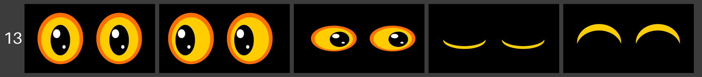

# Goofy

Goofy is a cat-shaped keychain with a tiny touch screen for a face. It runs on a
Waveshare ESP32-C6-Touch-LCD-1.47 board inside a 3D-printed case and can show
animated eyes, the song playing on your Spotify, or a slideshow of your photos.



## What it can do

| Program | What it shows | Source |
| --- | --- | --- |
| `eyes` | Animated eyes that sweep left and right and blink. 14 styles (googly, cat, robot, sleepy, heart, savage, cute amber and more). | [src/eyes.cpp](src/eyes.cpp) |
| `spotify` | Album art, title, artist and progress of the song playing on your Spotify account, with touch controls and an "up next" queue. | [src/spotify.cpp](src/spotify.cpp) |
| `photos` | A portrait photo frame. You upload pictures from a web page that the board serves. | [src/photos.cpp](src/photos.cpp) |
| `display_test`, `touch_test`, `wifi_test` | Small checks for the screen, the touch panel and the WiFi radio. | [src/](src/) |

Only one program is on the board at a time. You choose which one when you upload.

## Hardware

- Waveshare ESP32-C6-Touch-LCD-1.47 (ESP32-C6, 8 MB flash, 172x320 screen, AXS5106L touch)
- USB-C cable
- A case (ours is a 3D-printed orange cat; the screen sits sideways, ears at the top)

## Getting started

1. Install [VS Code](https://code.visualstudio.com/) and the
   [PlatformIO extension](https://platformio.org/install/ide?install=vscode).
2. Clone this repository and open the folder in VS Code.
3. Plug the board in with USB-C.
4. Upload the program you want:

   ```
   pio run -e eyes -t upload
   ```

   Replace `eyes` with `spotify`, `photos`, `display_test`, `touch_test` or `wifi_test`.
   If the upload cannot find the board, add `--upload-port COM6` (use your own port).

The first build downloads the ESP32 toolchain and takes several minutes.

## Eyes

- The eyes move slowly from one side to the other and blink at each side.
- Tap the screen and the eyes turn into happy arcs for a moment.
- Hold the screen, or press the BOOT button, to switch to the next style. The
  board remembers the style after a power cut.

Settings are at the top of [src/eyes.cpp](src/eyes.cpp):

| Setting | Meaning |
| --- | --- |
| `DEFAULT_LOOK` | Style shown on first start (0 to 13) |
| `SWEEP_MS` | Time for the eyes to cross the screen, in milliseconds |
| `HOLD_MS` | Pause at each side |
| `LOOK_EVERY_SWEEPS` | Change style automatically after this many sweeps (0 = never) |
| `LCD_BRIGHTNESS` | Backlight, 0 to 255 |
| `EYE_ROTATION` | Screen rotation |

Pictures of the styles are in [previews/](previews/).

## Spotify

Goofy uses the Spotify Web API. Showing the current song works with any
account. Changing songs from the keychain needs Spotify Premium.

### Set up once

1. Go to the [Spotify developer dashboard](https://developer.spotify.com/dashboard) and create an app.
2. Set the redirect URI to exactly `http://127.0.0.1:8888/callback` and tick "Web API".
3. Open the app's settings and note the Client ID and Client secret.
4. Run the login script on your PC (Python 3, no extra packages):

   ```
   python tools/spotify_login.py
   ```

   It asks for your WiFi name and password and the two Spotify keys, opens the
   Spotify login page in your browser, writes `include/secrets.h` and offers to
   upload the firmware.

You can also copy [include/secrets.example.h](include/secrets.example.h) to
`include/secrets.h` and fill it in by hand.

### Touch controls

| Touch | Action |
| --- | --- |
| Left third of the screen | Previous song |
| Right third | Next song |
| Middle, short tap | Play or pause |
| Middle, hold | Open the "up next" queue |
| A song in the queue | Play that song |

### WiFi notes

- The board only works on 2.4 GHz WiFi.
- Its antenna is small, so it needs to be close to the router. A phone hotspot
  in your pocket works well.
- You can save two networks; the board tries the first, then the second.

## Photo frame

1. Upload the `photos` program.
2. The board creates its own WiFi network and shows the network name, password
   and address on the screen.
3. Join that network with your phone, open the address and upload pictures.

To make the board join your home WiFi instead, fill in `WIFI_SSID` and
`WIFI_PASS` at the top of [src/photos.cpp](src/photos.cpp). Change `AP_PASS`
there as well if you want a different password for the board's own network.

## Keeping your keys private

`include/secrets.h` holds your WiFi password and Spotify keys. It is listed in
`.gitignore` and is not part of this repository. Do not commit it. If the keys
ever leak, press "Reset client secret" in the Spotify dashboard and run the
login script again.

## Project layout

```
include/board.h              pins and screen setup for the board
include/secrets.example.h    template for your WiFi and Spotify keys
lib/esp_lcd_touch_axs5106l/  touch panel driver
src/                         one .cpp file per program
tools/spotify_login.py       one-time Spotify login
previews/                    pictures of the eye styles
platformio.ini               build settings, one environment per program
```

## Build notes

- The project uses the [pioarduino](https://github.com/pioarduino/platform-espressif32)
  platform, release 54.03.21 (Arduino core 3.2.1), because the stock PlatformIO
  platform has no Arduino support for the ESP32-C6.
- GFX Library for Arduino is pinned to 1.5.9; it does not compile on core 3.3.x.

## Credits

- Screen and touch setup are based on the Waveshare demo code for this board.
- [GFX Library for Arduino](https://github.com/moononournation/Arduino_GFX),
  [ArduinoJson](https://arduinojson.org/) and
  [JPEGDEC](https://github.com/bitbank2/JPEGDEC).
